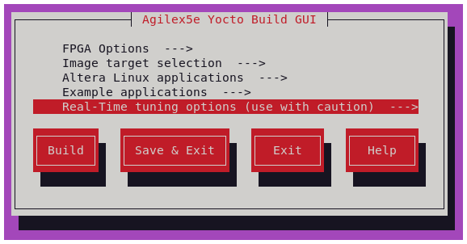

# Altera® FPGA Real-Time Meta Layer

Serves as a guideline to enable basic Real-Time features for Altera® SoC FPGA.
Intended as a plugin for Agilex™ 5 GSRD build based on KAS/YOCTO.

## Building an Image with this layer and kas

### Layers
The `altera-rt` layer should always be present in your configuration (main kas.yml).

```yml
  includes:
    - repo: meta-altera-rt
      file: meta-altera-rt/kas/rt.yml
(...)
```
### SoC FPGA RT Features and Variables
Optional build features can be enabled using the `SOCFPGA_RT_FEATURES` variable in your build config. The list of supported features can be found below.

| Feature | Description |
| --- | --- |
| rt-patch     | If enabled the Linux kernel is patched and configured with <br> `CONFIG_PREEMPT_RT=y`, `CONFIG_HIGH_RES_TIMERS=y` and `CONFIG_IRQ_FORCED_THREADING=y` |
| rt-atf-core3 | (Specific for Agilex™ 5) Adds the assembler fragment `core3_nl3a_cp_qos_plat_helpers.S` <br> to the ATF build. |
| rt-atf-core1 | (Specific for Agilex™ 5) Adds the assembler fragment `core1_nl3a_cp_qos_plat_helpers.S` <br> to the ATF build. |
| rt-core-isol | If `rt-core-isol` enabled, the Linux kernel is compiled with <br> `CONFIG_CPU_ISOLATION=y` |
| rt-irq-aff   | If `rt-irq-aff` enabled, the Linux kernel is compiled with <br> `CONFIG_GENERIC_IRQ_AFFINITY=y` and `CONFIG_ARM64_PSEUDO_NMI=y` |
| rt-no-hz-full| If `rt-no-hz-full` enabled, the Linux kernel is compiled with <br> `CONFIG_NO_HZ_FULL=y` |
| rt-rcu-nocbs | If `rt-rcu-nocbs` enabled, the Linux kernel is compiled with <br> `CONFIG_RCU_NOCB_CPU=y` |
| rt-utils     |  Linux and custom utilities for Real-Time activities |

The list of supported cvariables can be found below.

| Variable | Description |
| --- | --- |
| CPU_ISOL="<cpu_list>"       | Adds `isolcpus=<cpu_list>` and core list to u-boot boot arguments. |
| CPU_NO_HZ_FULL="<cpu_list>" | Adds `irqaffinity=<cpu_list>` and core list to u-boot boot arguments. |
| CPU_IRQ_AFF="<cpu_list>"    | Adds `nohz_full=<cpu_list>` and core list to u-boot boot arguments. |
| CPU_RCU_NOCBS="<cpu_list>"  | Adds `rcu_nocbs=<cpu_list>` and core list to u-boot boot arguments.|


An example of enabling features and variables in your build config (main kas.yml):
```yml
local_conf_header:
  aa-features: |
    SOCFPGA_RT_FEATURES:append = " rt-patch, rt-atf-core3, rt-core-isol, rt-irq-aff, rt-no-hz-full, rt-rcu-nocbs, rt-utils"
    CPU_ISOL="1,3"
    CPU_NO_HZ_FULL="1,3"
    CPU_IRQ_AFF="0,2"
    CPU_RCU_NOCBS="1,3"
(...)
```
Note: `aa- ` helps in gaining precedence in `local.conf` file.

Then build the image, for example:
```bash
kas build kas.yml
```

## Building an Image with this layer and kas/Kconfig

Get familiar with the [GSRD2.0 documentation for Agilex™ 5 Premium Development Kit](https://altera-fpga.github.io/latest/embedded-designs/agilex-5/e-series/premium/gsrd/ug-gsrd-agx5e-premium/#build-gsrd-20-binaries)
and fill the necessary dependencies for a KAS/YOCTO build. After getting the GSRD 2.0 repository,
navigate to `yocto_linux` directory:

```bash
    cd <gsrd_repository>/.../software/yocto_linux/
```

Clone this repository

```bash
    git clone https://github.com/altera-fpga/meta-altera-rt.git
```

Add the main GSRD `Kconfig` file to the GSRD build

```bash
    echo 'source "meta-altera-rt/kas/Kconfig"' >> Kconfig
```

Execute KAS command to open the GUI options. You should see "Real-Time tuning (use with caution)"

```bash
    kas menu
```

The following figure shows the configuration GUI.



Full documentation of this layer and options can be found at Altera® FPGA Developer Site.
See [Embedded Linux Real-Time Tuning using Kas/Yocto](https://altera-fpga.github.io/latest/real-time/embedded-linux/yocto-kas/)


